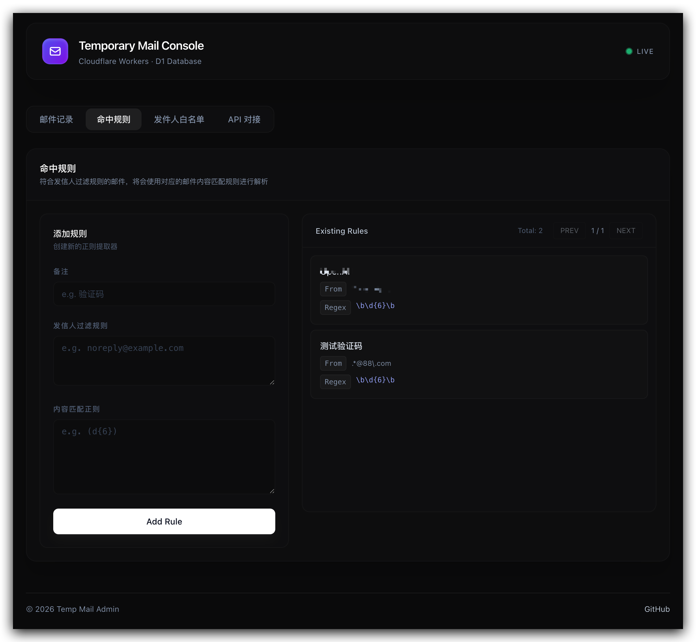

# Temp Mail Console

面向 **Cloudflare Free Plan** 构建的临时邮箱控制台，完全基于 Cloudflare 原生能力运行（Workers + D1 + Static Assets + Email Routing + Rate Limiting + Observability + Cron）。支持收信解析、正则提取、发件人白名单、全界面配置及 RESTful API 查询，开箱即用、零第三方运行时 CDN 依赖。

## 核心特性

- **开箱即用与防呆部署**：无需手写密钥配置文件；首次打开网页即可设置管理员密码并自动生成随机 `API_TOKEN`，随后在 **「系统设置」** 动态管理全局转发、令牌、密码与邮件保留时长。
- **邮件解析与规则引擎**：支持纯文本、主题、HTML 源码多目标正则提取（优先首个非空捕获组），支持原地启停、常用模板与在线正则试跑。
- **发件人白名单与原文沙箱**：基于正则过滤发件人并统计拦截次数；控制台支持邮件多维筛选、重新提取、HTML/纯文本/EML 原文预览及一键清空。
- **官方免费技术栈与安全防护**：前端预编译为本地静态资源并由 `HTMLRewriter` 按鉴权状态动态分发；内置 PBKDF2 密码哈希、`AUTH_LIMITER` 边缘限流防爆破、原生日志与防泄露部署预检。
- **双语双主题 + RESTful API**：支持中文 / English、深色 / 浅色实时切换，并提供 Bearer Token 外部查询接口与每小时 Cron 自动清理。

## 界面预览

<table>
  <tr>
    <td align="center"></td>
    <td align="center"></td>
    <td align="center"></td>
  </tr>
</table>

## 快速开始

### 方式一：一键部署（推荐）

[](https://deploy.workers.cloudflare.com/?url=https://github.com/8ey0u9/temp-mail-console)

1. 点击按钮授权 GitHub，Cloudflare 会自动创建 D1 数据库并部署 Static Assets 与 Worker。
2. 部署完成后直接访问分配的域名，设置管理员密码（不少于 8 位）即可完成初始化，同时自动生成随机 `API_TOKEN`。
3. 如需私有托管，一键部署完成后可在你的 GitHub 仓库 `Settings` 中将其改为 **Private**，Workers Builds 仍可正常触发构建。

### 方式二：本地开发与 CLI 部署

```bash
# 1. 安装依赖并启动本地服务（访问 http://localhost:8787）
npm install
npm run dev

# 2. 本地模拟投递测试邮件
curl -X POST "http://localhost:8787/cdn-cgi/handler/email?from=no-reply@acme-auth.io&to=alice.dev@yourdomain.com" \
  --data-binary @./test/fixtures/complex-magic-link.eml

# 3. 执行类型校验、单元测试、前端构建检查与集成测试
npm run check
```

手动发布上线：

```bash
npx wrangler d1 create temp-email-db
# 将输出的 database_id 填入 wrangler.jsonc 后执行（会自动应用 migrations 并完成发布预检）：
npm run deploy
```

> 常规数据库结构由 `migrations/0001_init.sql` 管理；同时代码内保留轻量的空库防呆建表（`ensureSchema`），保证一键部署空库可直接进入初始化向导。

## Email Routing 配置

1. 进入 Cloudflare 控制台 **Email -> Email Routing -> Routes**。
2. 为 **Catch-all** 或指定邮箱设置动作 **Send to a Worker**，目标选择 `temp-email-worker`。

> [!IMPORTANT]
> 选择 **Send to a Worker** 后，Cloudflare 不会同时将邮件投递到原收件箱。如需保留转发备份，请在控制台 **「系统设置 -> 全局邮件转发」** 开启并填写目标邮箱（需先在 Cloudflare `Email Routing -> Destination addresses` 中完成验证）。

## API 与规则说明

- **管理登录**：访问控制台输入管理员密码登录（签发 `HttpOnly` Cookie），管理接口亦支持 `Authorization: Bearer <ADMIN_TOKEN>`。
- **外部 API 鉴权**：请求头携带 `Authorization: Bearer <API_TOKEN>`（可在控制台「系统设置」查看或重新生成）。

| 接口 | 说明 |
|------|------|
| `GET /api/emails/latest` | 查询满足条件的最新一封邮件及提取结果 |
| `GET /api/emails` | 分页查询邮件列表（支持 `limit`，默认 20） |
| `GET /healthz` | 服务与 D1 数据库健康检查 |

**查询参数（适用于 `/api/emails/latest` 与 `/api/emails`）：**

| 参数 | 必填 | 说明 |
|------|------|------|
| `address` | 是 | 收件人邮箱（忽略大小写，支持多收件人及密送匹配） |
| `from` | 否 | 发件人邮箱关键字筛选（不区分大小写，子串匹配） |
| `since` | 否 | 毫秒时间戳，仅返回 `received_at > since` 的邮件 |
| `only_matched` | 否 | 设为 `true` 或 `1` 时仅返回至少命中一条规则的邮件 |

<details>
<summary>响应示例与规则字段说明</summary>

```json
{
  "code": 200,
  "data": {
    "message_id": "550e8400-e29b-41d4-a716-446655440000",
    "from_address": "noreply@example.com",
    "to_address": "user@yourdomain.com",
    "subject": "Verification Code",
    "received_at": 1741881600000,
    "results": [{ "rule_id": 1, "value": "123456", "remark": "验证码" }]
  }
}
```

- `match_target`：`body`（纯文本/清洗后正文）、`subject`（主题）、`both`（主题+正文）、`html`（原始 HTML 源码）。
- `sender_filter`：发信人过滤正则，支持逗号或换行分隔多个条件，留空表示匹配全部。
- `pattern`：提取正则；存在捕获组时返回首个非空捕获组，否则返回完整匹配。

</details>

## 项目结构

```
├── src/                    # Worker 后端（路由调度、D1 访问、MIME/正则解析、PBKDF2/HMAC 鉴权）
├── migrations/             # Cloudflare D1 官方迁移脚本（0001_init.sql）
├── public/                 # Static Assets（_headers、静态页 auth.html / console.html、预编译 CSS/Vue3）
├── scripts/                # Tailwind CSS 输入入口与发布/CI 防泄露预检脚本
├── test/                   # 单元测试、静态 UI 校验与 Miniflare 全链路集成测试
├── wrangler.jsonc          # Wrangler 官方配置（Assets / D1 / RateLimit / Observability / Cron）
└── tsconfig.json           # JSDoc + wrangler types 静态类型校验配置
```

## License

MIT
