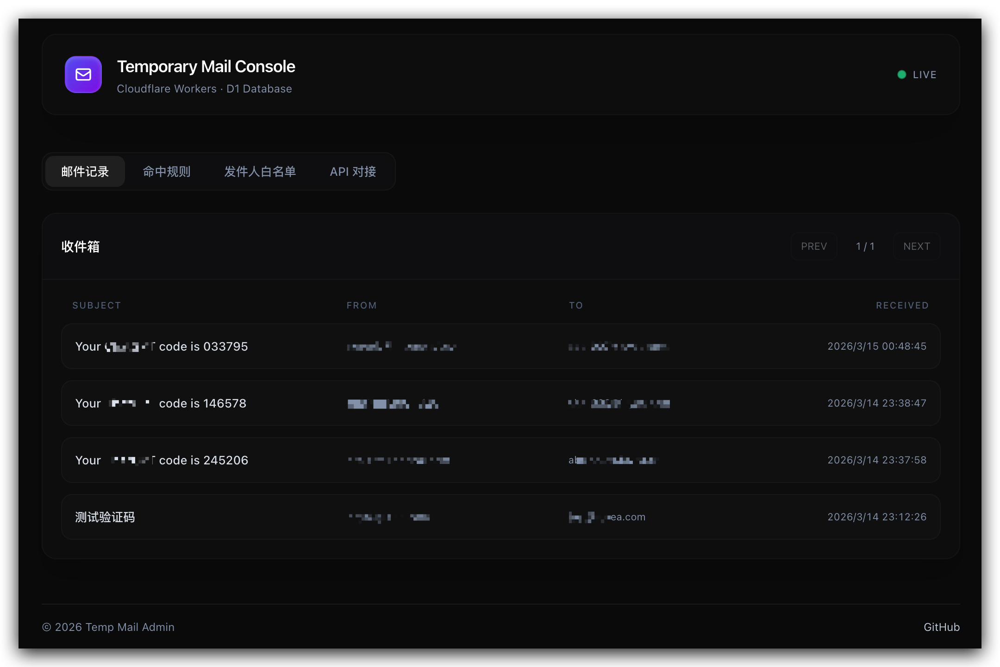
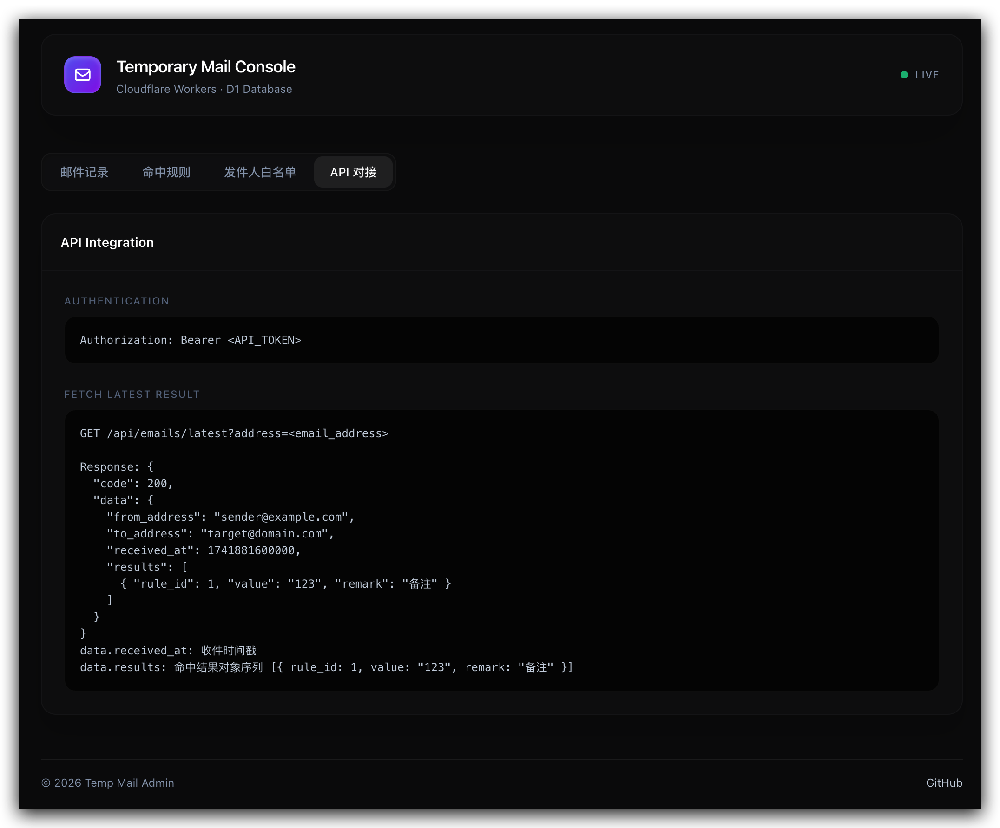

# Temp Mail Console

基于 **Cloudflare Workers + D1 + Static Assets** 的临时邮箱控制台。接收邮件后，根据可配置的正则规则自动提取关键数据（如验证码、登录链接），并通过控制台与 RESTful API 对外提供管理与查询能力。

## 功能特性

- 🧩 **控制台管理**：支持邮件多维筛选、命中状态徽章、重新提取、原文沙箱预览（HTML / 纯文本 / EML）及一键清空。
- 🧪 **规则与在线测试**：支持多目标正则匹配（主题 / 正文 / HTML 源码）、原地编辑启停、常用模板与在线试跑。
- 🌐 **双语与双主题**：支持中文 / English 实时切换，以及深色 / 浅色双主题模式。
- 🛡️ **发件人白名单**：基于正则表达式过滤发信人，支持启停控制与拦截统计；无启用规则时接收所有邮件。
- 🖥️ **RESTful API**：支持按收件人、发件人（`from`）、时间游标（`since`）及命中状态查询结果。
- ⚙️ **全界面配置与自动化**：转发邮箱、`API_TOKEN`、`ADMIN_TOKEN` 与保留时长均在「系统设置」实时调整，Cron 按设置自动清理过期记录。
- ☁️ **零密钥文件部署**：基于 Cloudflare Workers + D1 + Static Assets，支持首次网页初始化管理员并自动生成 `API_TOKEN`，内置防泄露安全门禁。

## 界面预览

<table>
  <tr>
    <td align="center"></td>
    <td align="center"></td>
    <td align="center"></td>
  </tr>
</table>

## 快速开始

### 方式一：一键部署（推荐）

[](https://deploy.workers.cloudflare.com/?url=https://github.com/8ey0u9/temp-mail-console)

> 无需修改任何密钥配置文件：点击上方按钮授权 GitHub 后会自动创建 D1 数据库、部署 Static Assets 与 Worker。
> 1. **首次网页初始化**：部署完成后直接打开分配的域名，按引导设置管理员登录密码（系统会同时自动生成随机 `API_TOKEN`）。随后可在控制台 **「系统设置」** 随时管理转发邮箱、`API_TOKEN`、管理员密码与邮件保留时长（全部存于你的私有 D1 数据库）。
> 2. **Fork 仓库建议**：Cloudflare 仅要求模板源仓库为 Public，**一键部署完成后可在你的 GitHub 仓库 Settings 中设为 Private（私有）**，Workers Builds 仍可正常构建。

---

### 方式二：本地开发与 CLI 部署

#### 1. 安装依赖与本地启动

```bash
npm install
npm run dev   # 访问 http://localhost:8787，首次打开按网页引导初始化密码即可
```

> 运行全部测试（单元测试 + i18n/UI 校验 + 打包预检 + Miniflare 集成测试）：
> ```bash
> npm test
> ```
> 本地调试 Email Handler 可使用内置测试夹具：
> ```bash
> curl -X POST "http://localhost:8787/cdn-cgi/handler/email?from=no-reply@acme-auth.io&to=alice.dev@yourdomain.com" \
>   --data-binary @./test/fixtures/complex-magic-link.eml
> ```

#### 2. 创建 D1 数据库并发布上线（手动 CLI 方式）

```bash
npx wrangler d1 create temp-email-db
# 将输出的 UUID 填入 wrangler.toml 的 database_id 字段后发布：
npm run deploy
```

> - 首次运行或访问会自动通过 `schema_meta` 完成幂等建表与版本迁移；无需手动填写任何环境变量配置文件。
> - `npm run deploy` 已内置 `predeploy` 门禁（CI 同步运行 `--ci` 防泄露检查），防止意外将密钥或真实转发邮箱写进 `wrangler.toml`。
> - 部署完成后可请求 `GET https://<your-worker-domain>/healthz` 验证服务连通性。

---

## 邮件路由配置 (Email Routing)

- 在 Cloudflare 控制台左侧菜单进入 **Email -> Email Routing -> Routes**
- 配置 **Catch-all address** 或具体的 **Custom addresses**，Destination 选择 `Send to a Worker` 并指向 `temp-email-worker`。

> [!IMPORTANT]
> 当动作设置为 **"Send to a Worker"** 时，Cloudflare 不会自动投递到原个人收件箱。如需同时转发原件，请在控制台 **「系统设置 -> 全局邮件转发」** 开启并填写目标邮箱（需先在 Cloudflare Email Routing -> Destination addresses 完成验证）。

---

## 管理控制台与 API

### 管理登录

- 访问 `https://<your-worker-domain>/`，输入 `ADMIN_TOKEN` 登录（服务端签发 `HttpOnly` Cookie）；也可在管理接口请求头携带 `Authorization: Bearer <ADMIN_TOKEN>`。

### 外部 API 鉴权

```
Authorization: Bearer <API_TOKEN>
```

### 查询最新命中结果

```
GET /api/emails/latest?address=<email_address>&from=<sender>&since=<timestamp_ms>&only_matched=true
```

| 参数 | 必填 | 说明 |
|------|------|------|
| `address` | 是 | 收件人邮箱（自动忽略大小写，支持多收件人及密送收件人） |
| `from` | 否 | 发件人邮箱关键字过滤（不区分大小写，子串匹配） |
| `since` | 否 | 毫秒时间戳，仅返回 `received_at > since` 的新邮件 |
| `only_matched` | 否 | 设为 `true` 或 `1` 时，仅返回至少命中一条规则的邮件 |

**响应：**

```json
{
  "code": 200,
  "data": {
    "message_id": "550e8400-e29b-41d4-a716-446655440000",
    "from_address": "noreply@example.com",
    "to_address": "user@yourdomain.com",
    "subject": "Verification Code",
    "received_at": 1741881600000,
    "results": [
      { "rule_id": 1, "value": "123456", "remark": "验证码" }
    ]
  }
}
```

### 查询邮件列表

```
GET /api/emails?address=<email_address>&from=<sender>&limit=20&since=<timestamp_ms>&only_matched=true
```

### 健康检查

```
GET /healthz
```

## 规则说明

| 字段 | 说明 |
|------|------|
| `remark` | 备注名称，作为返回结果的标签（可选） |
| `match_target` | 匹配范围：`body`（正文，自动清洗 HTML）、`subject`（主题）、`both`（主题+正文）、`html`（原始 HTML 源码） |
| `sender_filter` | 发信人过滤正则，多个用逗号或换行分隔，留空匹配所有 |
| `pattern` | 内容提取正则；存在捕获组时优先提取第一个非空捕获组，否则取完整匹配 |
| `enabled` | 是否启用规则（支持原地编辑与启停而不改变 `rule_id`） |

## 项目结构

```
├── src/
│   ├── index.js            # Worker 入口（Email / Fetch / Cron 路由调度）
│   ├── db.js               # D1 数据库操作与基于 schema_meta 的幂等版本迁移
│   ├── email.js            # 邮件解析、HTML 清洗、原文截断与正则提取引擎
│   ├── auth.js             # 常量时间鉴权与 HttpOnly Cookie 管理
│   ├── http.js             # HTTP 响应、安全头与参数工具
│   └── ui.js               # 精简 HTML 骨架渲染（登录页与控制台外壳）
├── public/
│   ├── _headers            # Cloudflare Static Assets 缓存与安全头规则
│   └── assets/
│       ├── theme.css       # 深色 / 浅色 CSS 变量主题与防闪烁样式
│       ├── preinit.js      # 首帧主题与语言同步初始化脚本
│       ├── i18n.js         # 中英双语字典与翻译助手
│       ├── auth.js         # 登录页交互脚本
│       └── console.js      # 控制台 Vue 3 应用脚本
├── scripts/
│   └── predeploy-check.mjs # 发布前配置安全门禁脚本
├── test/
│   ├── unit.test.js        # 核心逻辑单元测试
│   ├── ui-syntax.test.js   # 静态资源、i18n 键对齐与 HTML 模板校验
│   ├── integration.test.js # Miniflare + D1 + Assets 全链路集成测试
│   ├── sample.eml          # 基础测试邮件
│   └── fixtures/           # 复杂场景测试夹具（Base64 / Quoted-Printable / 附件）
├── .github/workflows/ci.yml # GitHub Actions CI 自动校验
├── schema.sql               # D1 建表语句
└── wrangler.toml            # Wrangler 配置（含 Static Assets 与 Cron Triggers）
```

## License

MIT
